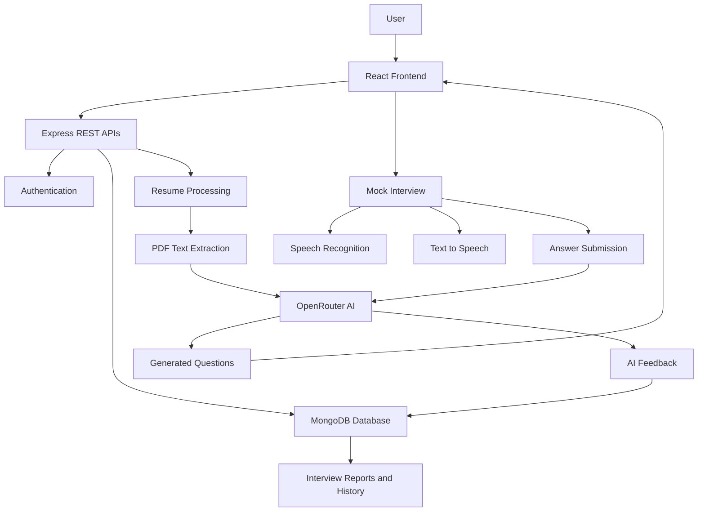

# 🚀 InterviewIQ.AI – AI-Powered Mock Interview Platform

<p align="center">
  <strong>Practice Smarter. Prepare Better. Crack Your Next Interview.</strong>
</p>

<p align="center">
  An AI-powered interview preparation platform that helps candidates practice technical and HR interviews, receive personalized questions, and improve their interview performance.
</p>

<p align="center">
  🌐 **Live Demo:** [InterviewIQ.AI](https://ai-interview-agent-1-client-p95o.onrender.com/)
</p>

---

## 📌 About The Project

**InterviewIQ.AI** is a full-stack AI-powered mock interview platform designed to help students and job seekers prepare for real-world technical and HR interviews.

The platform uses Artificial Intelligence to generate personalized interview questions based on the candidate's job role, experience, skills, projects, and uploaded resume.

Users can participate in interactive mock interviews, answer questions using voice input, receive AI-generated feedback, and review their interview performance.

The main objective of this project is to make interview preparation smarter, more accessible, and more effective through AI-powered assistance.

## ✨ Key Features

### 🤖 1. AI-Powered Question Generation
- Generate interview questions using AI.
- Personalized questions based on job role and experience.
- Supports Technical and HR interview modes.
- Questions tailored to candidate skills and projects.

### 📄 2. Resume Analysis
- Upload your resume in PDF format.
- Extract resume content using PDF parsing.
- Analyze candidate skills and projects.
- Generate interview questions based on resume information.

### 🎙️ 3. Interactive Mock Interviews
- Practice interviews in an interactive environment.
- AI-powered voice-based question delivery.
- Speech-to-text support for answering questions.
- Text-to-speech functionality for AI interview questions.
- Microphone controls for voice interaction.

### ⏱️ 4. Interview Timer
- Time-based interview questions.
- Track the time spent answering questions.
- Simulate a real interview environment.

### 📊 5. AI-Powered Feedback
- Submit answers for AI evaluation.
- Receive feedback on interview responses.
- Understand areas that need improvement.
- Review interview performance through generated reports.

### 📚 6. Interview History
- Access previously completed interviews.
- Review past interview attempts.
- Track your interview preparation journey.

### 🔐 7. User Authentication
- User authentication and session management.
- Protected user-specific interview information.
- Personalized interview experience.

### 💳 8. Credit-Based System
- Manage interview credits.
- Control AI-powered interview generation through a credit mechanism.

## 🛠️ Tech Stack

| Technology | Purpose |
|---|---|
| React.js | Frontend development |
| Vite | Frontend build tool |
| JavaScript | Application logic |
| Tailwind CSS | Styling and responsive UI |
| Redux Toolkit | Global state management |
| React Router | Client-side routing |
| Node.js | Backend runtime |
| Express.js | REST API development |
| MongoDB | Database |
| Mongoose | Database modeling |
| OpenRouter AI | AI-powered question generation and evaluation |
| Multer | Resume file uploads |
| PDF.js | PDF text extraction |
| Web Speech API | Speech recognition and voice interaction |
| Axios | API communication |
| Render | Application deployment |
| Git & GitHub | Version control |

## 🏗️ Application Architecture

The application follows a client-server architecture.



## 🔄 How It Works

1. **Sign Up / Login:** Users access the platform through authentication.
2. **Set Up Interview:** Select the desired job role, experience level, and interview type.
3. **Upload Resume:** Upload a PDF resume for personalized interview preparation.
4. **Generate Questions:** The backend processes the candidate information and requests AI-generated interview questions.
5. **Start Interview:** Answer the generated questions in an interactive interview environment.
6. **Submit Answers:** Submit responses for AI-powered evaluation.
7. **Get Feedback:** Receive feedback and review your interview performance.
8. **View History:** Access previous interview attempts and reports.

## 📂 Project Structure

```text
AI-interview-agent/
│
├── client/
│   ├── public/
│   ├── src/
│   │   ├── components/
│   │   ├── pages/
│   │   ├── redux/
│   │   ├── assets/
│   │   ├── App.jsx
│   │   └── main.jsx
│   ├── package.json
│   └── vite.config.js
│
├── server/
│   ├── config/
│   ├── controllers/
│   ├── models/
│   ├── routes/
│   ├── middleware/
│   ├── public/
│   ├── index.js
│   └── package.json
│
└── README.md
```

*Note: Adjust the directory names to match your actual repository structure.*

## ⚙️ Installation & Setup

Follow these steps to run the project locally.

### 1. Clone the Repository

```bash
git clone https://github.com/Vivek9310/AI-interview-agent.git
```

```bash
cd AI-interview-agent
```

### 2. Setup Frontend

```bash
cd client
npm install
npm run dev
```

Frontend will run at:

```text
http://localhost:5173
```

### 3. Setup Backend

Open another terminal:

```bash
cd server
npm install
npm run dev
```

Backend will run at:

```text
http://localhost:8000
```

## 🔑 Environment Variables

Create a `.env` file in the backend directory and configure your environment variables according to your application configuration.

```env
PORT=8000
MONGODB_URI=your_mongodb_connection_string
OPENROUTER_API_KEY=your_openrouter_api_key
CLIENT_URL=http://localhost:5173
```

If your authentication implementation requires additional credentials, configure those as well.

**Important:** Never expose API keys, database credentials, or other sensitive information in your GitHub repository.

## 🧠 AI Integration

InterviewIQ.AI integrates an AI model through the **OpenRouter API**.

The AI integration is used for:

- Generating personalized interview questions.
- Using resume information as additional context.
- Evaluating candidate answers.
- Providing constructive interview feedback.

The backend communicates with the AI service and processes its responses before returning the results to the frontend.

## 🎯 Project Objectives

- Simplify interview preparation using Artificial Intelligence.
- Provide personalized interview experiences.
- Help candidates identify their strengths and weaknesses.
- Make technical and HR interview practice accessible.
- Improve confidence through repeated mock interviews.

## 🚀 Future Enhancements

- Advanced interview performance analytics.
- More detailed skill-gap analysis.
- Additional interview categories.
- Improved AI feedback and answer scoring.
- Interview preparation recommendations.
- More personalized learning suggestions.

## 👨‍💻 Developer

**Vivek Tiwari**

B.Tech | Maharaja Surajmal Institute of Technology

Interested in Full Stack Development, MERN Stack, Java, and Problem Solving.

<p align="left">
  <a href="https://github.com/Vivek9310">
    
  </a>
  <a href="https://ai-interview-agent-1-client-p95o.onrender.com/">
    
  </a>
</p>

---

<p align="center">
  ⭐ If you find this project interesting, consider giving it a star!
</p>

<p align="center">
  **Built with ❤️ by Vivek Tiwari**
</p>
